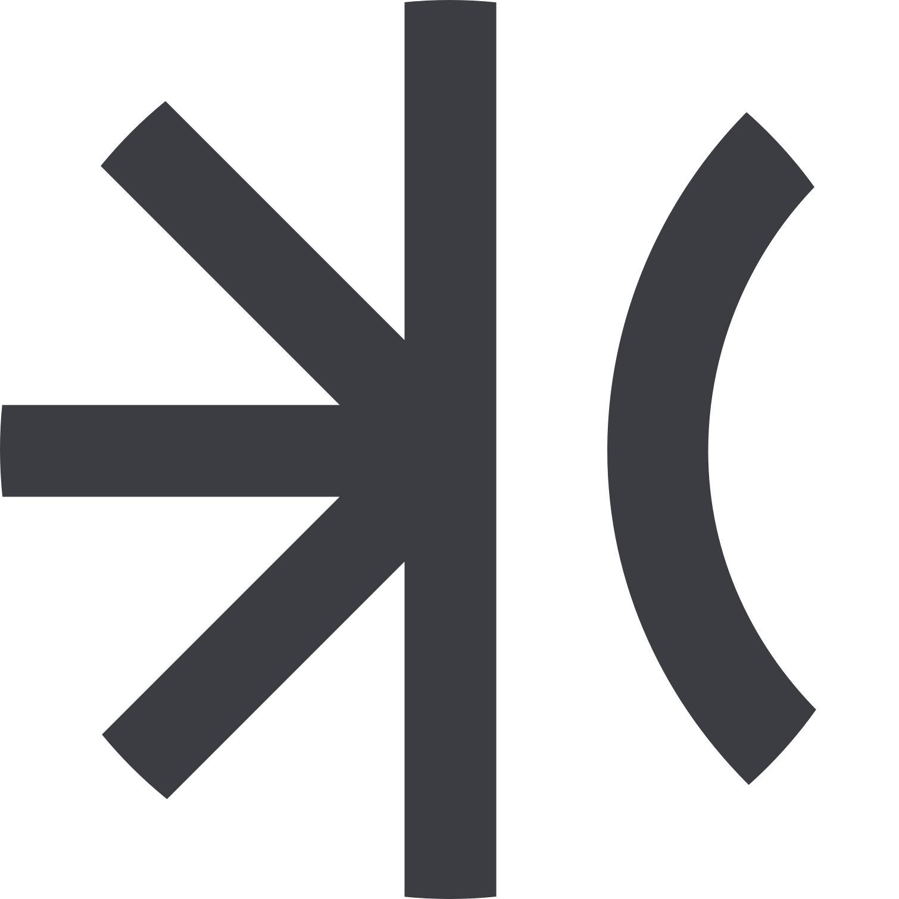

# Payment Providers

Using one of these payment packages? Then you track payments with **one line of config**. No migration, no payment model, no webhook listener. Available since version 6.2 of the [Laravel client](installation.md).

<div class="provider-cloud">
  <a href="#cashier-stripe"><span>Stripe<small>via Cashier</small></span></a>
  <a href="#cashier-paddle"><span>Paddle<small>via Cashier</small></span></a>
  <a href="#cashier-mollie"><span><small>via Cashier</small></span></a>
  <a href="#polar"><span>Polar</span></a>
  <a href="#your-provider-is-not-listed"><span class="any">&lt;/&gt;</span><span>Any other<small>your own model</small></span></a>
</div>

Your provider is not listed, or you store payments in your own table? That works just as well: implement one interface on your payment model, see [How to track a new payment](how-to-track-a-new-payment.md).

## Setup

Set the provider class in your config and leave the payment model empty:

```php
//config/simplestats-client.php

use SimpleStatsIo\LaravelClient\PaymentProviders\CashierStripe;

    'tracking_types' => [
        // ...

        'payment' => [
            'provider' => CashierStripe::class,
            'model' => null,
        ],
    ],
```

Three things are needed for every provider:

- **Your user model implements `TrackablePerson`**, as described in [How to track a new user](how-to-track-a-new-user.md). Payments are linked to the paying user, which is what attributes revenue to the channel the user came from. If your billable model is not a user (for example a team), use [your own payment model](how-to-track-a-new-payment.md) instead.
- **A queue worker runs**, because the payments of some providers (and Paddle refunds) are processed as queued jobs. See [Queue](queue.md).
- **Your webhook receives the events listed for your provider below.** Cashier and the other packages do not enable them for you. An event that is not enabled in your provider's dashboard never reaches your app, so its payments or refunds are silently missing.

Then check the setup:

```bash
php artisan simplestats:status
```

It shows the active provider and tells you when its package is missing or when a payment model is set as well.

## What gets tracked

- **Only completed payments.** Pending or failed payments are skipped, an authorization without capture as well.
- **Refunds** update the payment to the amount that is left. A full refund removes the payment, so it no longer counts as revenue, paying user or subscription.
- **Gross and net.** Net is the gross amount without the tax share.
- **Subscriptions.** Monthly and yearly plans are tracked with their interval and plan name, which powers MRR and ARR. Other billing cycles (weekly, quarterly) count as one time payments.

## Cashier Stripe

Package: [`laravel/cashier`](https://laravel.com/docs/billing)

```php
'provider' => \SimpleStatsIo\LaravelClient\PaymentProviders\CashierStripe::class,
```

Cashier Stripe stores no payments, so the client listens to Cashier's webhook and reads each charge from the Stripe API.

::: warning Enable the charge events
Cashier's webhook endpoint does not receive charge events by default, and without them no payment is tracked. In your Stripe dashboard, add these events to the endpoint of your Cashier webhook (`/stripe/webhook`):

`charge.succeeded`, `charge.captured`, `charge.refunded`, `charge.refund.updated`, `charge.dispute.closed`
:::

Good to know:

- Net is read from the invoice. Payments without an invoice (for example a one time Checkout payment) are tracked with net equal to gross.
- Charges without a Cashier customer (guest payments) are not tracked, because they belong to no user.
- A lost dispute is handled like a refund.

## Cashier Paddle

Package: [`laravel/cashier-paddle`](https://laravel.com/docs/cashier-paddle)

```php
'provider' => \SimpleStatsIo\LaravelClient\PaymentProviders\CashierPaddle::class,
```

Payments are tracked from the transactions Cashier stores. Paddle books refunds as adjustments, which Cashier does not process, so the client reads them from the webhook itself.

::: warning Enable the transaction and adjustment events
Without the adjustment events, refunds are not tracked. In your Paddle dashboard, add these events to the notification destination of your Cashier webhook (`/paddle/webhook`):

`transaction.completed`, `transaction.updated`, `adjustment.created`, `adjustment.updated`
:::

A refund is tracked once Paddle has approved it, which can take a while after you issued it.

## Cashier Mollie <Badge type="warning" text="Beta" /> {#cashier-mollie}

::: info Beta
This provider is covered by automated tests, but not yet tested against a live Mollie account. Payments missing or wrong? Please [open an issue](https://github.com/simplestats-io/laravel-client/issues).
:::

Package: [`mollie/laravel-cashier-mollie`](https://github.com/mollie/laravel-cashier-mollie)

```php
'provider' => \SimpleStatsIo\LaravelClient\PaymentProviders\CashierMollie::class,
```

Payments are tracked from the orders Cashier Mollie stores, first payments as well as renewals. There is nothing to enable in your Mollie dashboard, Cashier sets the webhook for every payment itself.

::: info Refunds
Cashier Mollie only processes refunds started through Cashier (for example `$order->refundCompletely()`). A refund made directly in the Mollie dashboard does not reach your app and is therefore not tracked.
:::

## Polar <Badge type="warning" text="Beta" /> {#polar}

::: info Beta
This provider is covered by automated tests, but not yet tested against a live Polar account. Payments missing or wrong? Please [open an issue](https://github.com/simplestats-io/laravel-client/issues).
:::

Package: [`danestves/laravel-polar`](https://github.com/danestves/laravel-polar) (requires PHP 8.3)

```php
'provider' => \SimpleStatsIo\LaravelClient\PaymentProviders\Polar::class,
```

Polar creates an order for every purchase and every subscription cycle, so renewals are tracked like purchases.

::: warning Enable the order events
Without these events, payments and refunds are not tracked. In your Polar webhook settings, enable:

`order.paid`, `order.refunded`
:::

## Lemon Squeezy <Badge type="danger" text="Ending" /> {#lemon-squeezy}

::: danger Lemon Squeezy is winding down
Lemon Squeezy closed new sign ups on November 16, 2026 and stops processing payments on March 31, 2027. Existing stores move to Stripe Managed Payments, see the [Lemon Squeezy migration guide](https://docs.lemonsqueezy.com/migration). This provider keeps working for existing stores until then. It is not tested against a live Lemon Squeezy account, since new test accounts are no longer possible.
:::

Package: [`lemonsqueezy/laravel`](https://github.com/lmsqueezy/laravel)

```php
'provider' => \SimpleStatsIo\LaravelClient\PaymentProviders\LemonSqueezy::class,
```

Every purchase is an order, including the first payment of a subscription. Renewals are tracked from the subscription invoices.

::: warning Enable the order and subscription events
Without these events, payments and refunds are not tracked. In your Lemon Squeezy webhook settings, enable:

`order_created`, `order_refunded`, `subscription_created`, `subscription_payment_success`, `subscription_payment_refunded`
:::

## Switching from your own payment model

Already tracking payments with your own model? Set `provider`, set `model` to `null` and remove the contract from your model. Payments you tracked before stay as they are.

- **Cashier Paddle, Lemon Squeezy:** if your model extended the package's model (`Laravel\Paddle\Transaction`, `LemonSqueezy\Laravel\Order`), the provider uses the same payment ids, so the switch is seamless.
- **Any other own model:** the providers of Cashier Paddle, Cashier Mollie, Lemon Squeezy and Polar use the ids of the package's local orders, which can collide with the ids of your old payments. In that case keep your own model.

Never set `provider` and `model` at the same time, or payments are tracked twice.

## Your provider is not listed?

You have two options:

1. **Use your own payment model.** Implement the `TrackablePayment` contract on the model that holds your payments, see [How to track a new payment](how-to-track-a-new-payment.md). This works with every provider and every custom setup.
2. **Write a provider.** Any class implementing `SimpleStatsIo\LaravelClient\PaymentProviders\PaymentProvider` can be set as `provider`. Look at the [built in providers](https://github.com/simplestats-io/laravel-client/tree/main/src/PaymentProviders) for examples. We are happy to receive a pull request for a provider others can use too.

<style>
.provider-cloud {
  display: grid;
  grid-template-columns: repeat(auto-fill, minmax(150px, 1fr));
  gap: 12px;
  margin: 24px 0;
}
.vp-doc .provider-cloud a {
  display: flex;
  align-items: center;
  gap: 12px;
  padding: 12px 16px;
  border: 1px solid var(--vp-c-divider);
  border-radius: 12px;
  color: var(--vp-c-text-1);
  font-weight: 600;
  text-decoration: none;
  transition: border-color 0.3s cubic-bezier(0.22, 1, 0.36, 1);
}
.vp-doc .provider-cloud a:hover {
  border-color: var(--vp-c-brand-1);
}
.provider-cloud img {
  width: 24px;
  height: 24px;
  margin: 0;
}
.provider-cloud img.wordmark {
  width: auto;
  height: 16px;
}
.provider-cloud span {
  display: flex;
  flex-direction: column;
  line-height: 1.2;
}
.provider-cloud small {
  color: var(--vp-c-text-2);
  font-size: 12px;
  font-weight: 400;
}
.provider-cloud .any {
  font-family: var(--vp-font-family-mono);
  font-size: 14px;
}
.dark .provider-cloud img {
  filter: invert(1);
}
</style>
